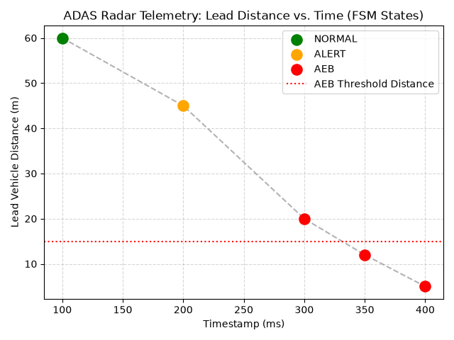

# ADAS Sensor Telemetry Pipeline & Active Safety Controller

A real-time Advanced Driver-Assistance Systems (ADAS) telemetry pipeline written in Python. This module simulates front-radar CAN bus data ingestion (`0x1A0`), enforces fault-tolerant boundary validation, calculates dynamic Time-to-Collision (TTC), and drives a deterministic Finite State Machine (FSM) managing `NORMAL`, `ALERT`, and `AEB_ENGAGED` (Autonomous Emergency Braking) states.

## Key Engineering Features
- **CAN Bus Frame Simulation:** Ingests structured radar telemetry packets containing arbitration IDs (`0x1A0`), timestamps, vehicle speed, lead obstacle distance, and relative closing velocity.
- **Fault-Tolerant Anomaly Filtering:** Rejects malformed frames, negative distance anomalies, unphysical velocity spikes, and hardware sensor fault flags while preserving system state determinism.
- **Kinematic Time-to-Collision (TTC) Engine:** Computes real-time closure rates ($TTC = \frac{\text{Distance}}{\text{Relative Velocity}}$) to evaluate collision risk across varying speeds.
- **Active Safety State Machine:** Transitions deterministically between `NORMAL` cruising, driver `ALERT` ($TTC \le 2.8\text{s}$), and `AEB_ENGAGED` ($TTC \le 1.5\text{s}$).
- **Automated Unit Testing & Visualization:** Includes a full `unittest` suite verifying boundary edge cases and `matplotlib` telemetry state plotting.

## Telemetry State Visualization


## Sample Console Output
```text
--- INITIATING ADAS TELEMETRY PROCESSING LOOP ---
Time: 100ms | Dist: 60.0m | TTC: N/A (Safe) | State: NORMAL
Time: 200ms | Dist: 45.0m | TTC: 2.50s | State: ALERT
Time: 300ms | Dist: 12.0m | TTC: 0.80s | State: AEB_ENGAGED
Time: 400ms | Dist: -2.0m | TTC: N/A (Safe) | State: AEB_ENGAGED

Processing Complete: 3 valid frames | 1 dropped anomalies